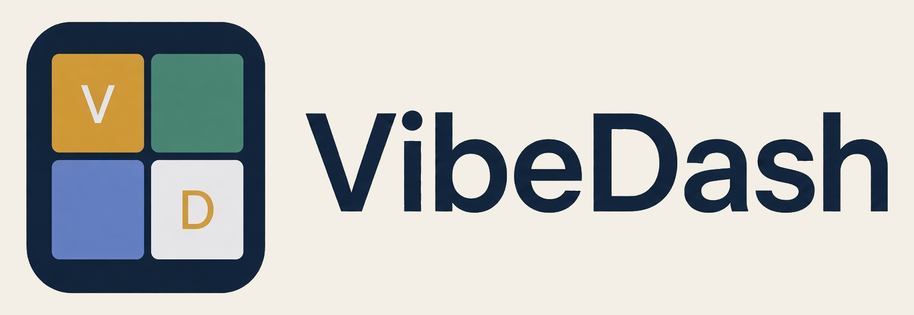

# VibeDash

[Français](README.md) · [English](README.en.md) · [Español](README.es.md)



Local dashboard for vibe-coding. It tracks a project’s **decisions**, **milestones** and **sales** notes on your own machine, with no account.

The screen is in French. This guide is here so the same tool can be understood in English.

## What it is

One browser page shows one or more projects. Each project is a tab. The words come from Markdown files in that project. The dashboard reads them. It does not rewrite them.

## What it is not

- No cloud, no account, no Docker, no downloaded web font.
- The server listens on **127.0.0.1** only. It does not listen on the local network.
- Closing a tab does not delete the project files.
- The `port` field inside a project is not the port of the dashboard.

## Run

Python 3.11 or newer, standard library only.

```bash
./bin/dashboard
```

Open `http://127.0.0.1:3847`. **Ouvrir**, or the `o` key, asks for a project folder that already contains a `dashboard.toml`. Nothing is written into that folder.

```bash
./bin/dashboard --project /path/to/a/project
```

From a project folder, empty or not:

```bash
/path/to/this/repository/bin/dashboard init
/path/to/this/repository/bin/dashboard serve
```

`init` writes `dashboard.toml` and `DECISIONS.md` only when they are missing. It does not overwrite. Paths inside the toml stay relative to the project. `serve` opens that folder in the dashboard.

With no subcommand, the same folder is opened as soon as it already contains a `dashboard.toml`. `--dump` without `--project` then reads that folder. The printed JSON does not contain the folder path.

If `dashboard-moteur/server.py` exists in the current folder and that file stays inside `dashboard-moteur/`, that engine runs. A link that leaves this folder is ignored: the engine from this repository is used.

`init --vendor` copies the engine into `dashboard-moteur/` (without the tests) and writes `scripts/dashboard.sh`. Nothing is overwritten. That script contains no path to this repository. From the project folder, including after the folder has been copied elsewhere:

```bash
./scripts/dashboard.sh
```

A relative path starts from the directory where you run the command. Projects you have opened come back the next time. Their paths stay in a local registry (`$XDG_CONFIG_HOME/dashboard-projet/projets.json`, or `~/.config/dashboard-projet/projets.json`). They are not stored in this repository.

`--port` changes the dashboard port. The default is 3847. Ctrl+C stops the whole dashboard.

## Files in a project

| File | Role |
|---|---|
| `dashboard.toml` | Name, milestones, constraints, sales cards |
| `DECISIONS.md` | A decision table, then one section per id |
| `J0.md`, `J1.md`, … | If the file exists, that milestone is done |
| `dashboard-moteur/` | Copy of the engine, only after `init --vendor` |
| `scripts/dashboard.sh` | Starts that copy, with no path to this repository |

The full format is in `SCHEMA.md` (French). A blank copy is in `modele/`.

## Keyboard

| Key | Action |
|---|---|
| `o` | Open a project |
| `/` or `Ctrl+K` | Search |
| `↑` / `↓` | In the search, next or previous line |
| `g` then `i`, `d`, `j` or `v` | Now, Decisions, Milestones, Sales |
| `j` / `k` | Next / previous item |
| Enter | Open the card |
| `t` | Light or dark theme |
| `?` | Help |
| Esc | Close |

## Check

```bash
python3 -m unittest discover -s moteur/tests -v
```

## License

Copyright (c) 2026 VibeDash contributors.

MIT. The text is in [LICENSE](LICENSE).
