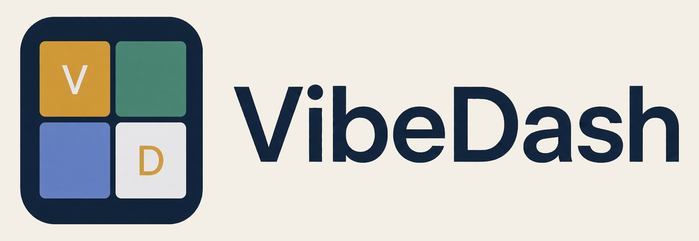

# VibeDash

[Français](README.md) · [English](README.en.md) · [Español](README.es.md)



Tablero local para el vibe-coding. Sigue las **decisiones**, los **hitos** y las notas de **venta** de un proyecto, en el propio equipo, sin cuenta.

La pantalla está en francés. Esta guía explica la misma herramienta en español.

## Para qué sirve

Una sola página del navegador muestra uno o varios proyectos. Cada proyecto es una pestaña. Los textos salen de archivos Markdown del proyecto. El tablero los lee. No los reescribe.

## Lo que no hace

- Sin nube, sin cuenta, sin Docker, sin una fuente descargada de la web.
- El servidor escucha solo en **127.0.0.1**. No escucha en la red local.
- Cerrar una pestaña no borra los archivos del proyecto.
- El campo `port` de un proyecto no es el puerto del tablero.

## Arranque

Python 3.11 o más reciente, solo la biblioteca estándar.

```bash
./bin/dashboard
```

Abrir `http://127.0.0.1:3847`. **Ouvrir**, o la tecla `o`, pide la carpeta de un proyecto que ya tenga un `dashboard.toml`. No se escribe nada en esa carpeta.

```bash
./bin/dashboard --project /ruta/hacia/un/proyecto
```

Desde la carpeta de un proyecto, vacía o no:

```bash
/ruta/hacia/este/repositorio/bin/dashboard init
/ruta/hacia/este/repositorio/bin/dashboard serve
```

`init` escribe `dashboard.toml` y `DECISIONS.md` solo si faltan. No sobrescribe. Las rutas del toml siguen siendo relativas al proyecto. `serve` abre esa carpeta en el tablero.

Sin subcomando, la misma carpeta se abre en cuanto ya contiene un `dashboard.toml`. `--dump` sin `--project` lee entonces esa carpeta. El JSON mostrado no contiene la ruta de la carpeta.

Si existe `dashboard-moteur/server.py` en la carpeta actual y ese archivo permanece dentro de `dashboard-moteur/`, se usa ese motor. Un enlace que sale de esta carpeta se ignora: se usa el motor de este repositorio.

Una ruta relativa parte de la carpeta donde se lanza el comando. Los proyectos ya abiertos vuelven la próxima vez. Sus rutas quedan en un registro local (`$XDG_CONFIG_HOME/dashboard-projet/projets.json`, o `~/.config/dashboard-projet/projets.json`). No están en este repositorio.

`--port` cambia el puerto del tablero. El valor por defecto es 3847. Ctrl+C detiene todo el tablero.

## Archivos de un proyecto

| Archivo | Función |
|---|---|
| `dashboard.toml` | Nombre, hitos, reglas, fichas de venta |
| `DECISIONS.md` | Tabla de decisiones y una sección por identificador |
| `J0.md`, `J1.md`, … | Si el archivo existe, el hito está hecho |

El formato completo está en `SCHEMA.md` (francés). Un modelo vacío está en `modele/`.

## Teclado

| Tecla | Acción |
|---|---|
| `o` | Abrir un proyecto |
| `/` | Buscar |
| `g` y luego `i`, `d`, `j` o `v` | Ahora, Decisiones, Hitos, Venta |
| `j` / `k` | Elemento siguiente / anterior |
| Intro | Abrir la ficha |
| `t` | Tema claro u oscuro |
| `?` | Ayuda |
| Esc | Cerrar |

## Comprobar

```bash
python3 -m unittest discover -s moteur/tests -v
```

## Licencia

Copyright (c) 2026 VibeDash contributors.

MIT. El texto está en [LICENSE](LICENSE).
