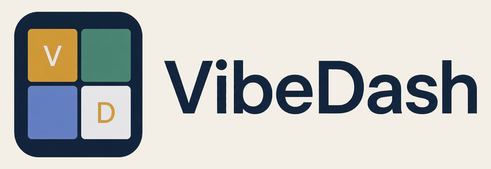

# VibeDash

[Français](README.md) · [English](README.en.md) · [Español](README.es.md)



Tableau local pour le vibe-coding. Il suit les **décisions**, les **jalons** et la **vente** d’un projet, sur la machine, sans compte.

L’interface est en français. Ce guide existe en trois langues pour expliquer le même outil.

## À quoi ça sert

Un seul tableau ouvert dans le navigateur montre un ou plusieurs projets. Chaque projet est un onglet. Les textes viennent des fichiers Markdown du projet : le tableau les lit, il ne les remplace pas.

## Ce que ça ne fait pas

- Pas de cloud, pas de compte, pas de Docker, pas de police téléchargée.
- Le serveur écoute **127.0.0.1** seulement. Il n’écoute pas le réseau local.
- Retirer un onglet ne supprime pas les fichiers du projet.
- Le champ `port` d’un projet n’est pas le port du tableau.

## Lancer

Python 3.11 ou plus récent, bibliothèque standard.

```bash
./bin/dashboard
```

Ouvrir `http://127.0.0.1:3847`. **Ouvrir**, ou la touche `o`, demande le dossier d’un projet qui contient déjà un `dashboard.toml`. Rien n’est écrit dans ce dossier.

```bash
./bin/dashboard --project /chemin/vers/un/projet
```

Dans un dossier de projet, vide ou pas :

```bash
/chemin/vers/ce/dépôt/bin/dashboard init
/chemin/vers/ce/dépôt/bin/dashboard serve
```

`init` écrit `dashboard.toml` et `DECISIONS.md` seulement s'ils manquent. Il n'écrase rien. Les chemins dans le toml restent relatifs au projet. `serve` ouvre ce dossier dans le tableau.

Un chemin relatif part du dossier où la commande est lancée. Les projets déjà ouverts reviennent au prochain lancement. Leurs chemins restent dans un registre local (`$XDG_CONFIG_HOME/dashboard-projet/projets.json`, sinon `~/.config/dashboard-projet/projets.json`), pas dans ce dépôt.

`--port` change le port du tableau. Le défaut est 3847. Ctrl+C arrête tout le tableau.

## Fichiers d’un projet

| Fichier | Rôle |
|---|---|
| `dashboard.toml` | Nom, jalons, contraintes, cartes de vente |
| `DECISIONS.md` | Tableau des décisions, puis une section par identifiant |
| `J0.md`, `J1.md`, … | Un fichier présent signifie que le jalon est fait |

Le détail du format est dans `SCHEMA.md`. Un squelette est dans `modele/`.

## Clavier

| Touche | Action |
|---|---|
| `o` | Ouvrir un projet |
| `/` | Chercher |
| `g` puis `i`, `d`, `j` ou `v` | Maintenant, Décisions, Jalons, Vente |
| `j` / `k` | Élément suivant / précédent |
| Entrée | Ouvrir la carte |
| `t` | Thème clair ou sombre |
| `?` | Aide |
| Échap | Fermer |

## Vérifier

```bash
python3 -m unittest discover -s moteur/tests -v
```

## Licence

Copyright (c) 2026 VibeDash contributors.

MIT. Le texte est dans [LICENSE](LICENSE).
